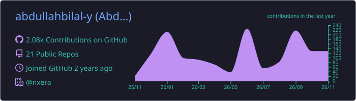
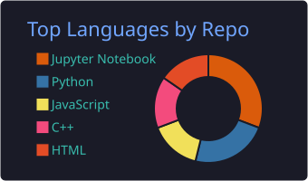

---

🚀 AI Engineer

Building production LLM voice agents, vision-grounded automation and the tools around them.

<strong>Python | TypeScript | FastAPI | React | Next.js | Supabase | Docker | LLMs & Computer Vision</strong>

 

---

<!-- Table keeps the intro and avatar side by side without breaking the layout -->
<table>
  <tr>
    <td width="75%" valign="top" style="border: none;">
      <h1>CURRICULUM VITAE</h1>
      

        <a href="#">Profile</a> | <a href="#education">Education</a> | <a href="#my-skill">My Skill</a> | <a href="#working-experiences">Working Experiences</a> | <a href="#projects">Projects</a> | <a href="#languages">Languages</a>
      

      <h2>Abdullah Bilal</h2>
      <!-- Badges -->
      
      
      
      
        
      Hi There👋, My name is <b>Abdullah Bilal</b>. I am an AI Engineer specialising in production LLM agents, prompt design and automated workflows. I built the conversation engine for a voice agent handling over 5,000 calls a day with sub-second responses, and I build vision-grounded desktop agents that read the screen instead of relying on brittle selectors.
    </td>
    <td width="25%" valign="top" align="center" style="border: none;">
       
      
    </td>
  </tr>
</table>

### Languages

- <b>Urdu:</b> Native
- <b>English:</b> Professional

### Education

- <b><a href="https://szabist-isb.edu.pk" target="_blank">SZABIST, Islamabad:
  </a></b> - Artificial Intelligence 
  Shaheed Zulfikar Ali Bhutto Institute of Science and Technology 
  Bachelor's Degree (Expected Graduation: Feb 2027)

### My Skill

#### 💻 Programming Languages

#### 🌐 Frontend & Desktop

#### 🛠 Backend & Frameworks

 
 

#### 🗄 Cloud & DevOps

 
  

#### 🤖 AI & Machine Learning

 
      

### Working Experiences

- <b>Ibras 95 Transport L.L.C.</b>
  <b>Enterprise PMO</b> - Jun 2026 - Present (Remote)
   
  Built the logistics tracking platform and the backend data models and API layer behind its real-time tracking, plus centralized container-document storage and search that replaced hours of scrolling through WhatsApp groups.
   
  <b>Skills & Tools:</b> React, TypeScript, Supabase, PostgreSQL, OCR
    

- <b>Nxera</b>
  <b>AI & Automation Developer (Freelance)</b> - Jun 2025 - Present (Remote)
   
  Independent AI and automation work, including AI Screen Pilot (a vision-grounded desktop agent) and Nxera Core (an automation workflow engine).
   
  <b>Skills & Tools:</b> Python, TypeScript, Node.js, PostgreSQL, LLMs, Computer Vision
    

- <b>Prime BPO</b>
  <b>AI Engineer</b> - Aug 2025 - Jun 2026
   
  Built the LLM conversation engine for AiCCA, a production AI voice agent handling over 5,000 calls daily with sub-second response times. Reduced TTS API costs by 50% and integrated the agent with the VICIdial dialer and CRM workflow.
   
  <b>Skills & Tools:</b> Python, OpenRouter API, STT/TTS, Docker, Prometheus, Grafana
   

### Projects

| Project | What it is | Stack |
| :--- | :--- | :--- |
| <b><a href="https://github.com/abdullahbilal-y/3drossa">3drossa</a></b> | Engine for scroll-driven 3D web experiences, with a visual path editor that runs inside your own page. Published on npm. | JavaScript |
| <b><a href="https://github.com/abdullahbilal-y/devsetgo">devsetgo</a></b> | CLI that generates a runnable code playground and architecture diagrams straight from your source code. Published on npm. | TypeScript |
| <b><a href="https://github.com/abdullahbilal-y/islamabad-air">Hawa</a></b> | Open archive, API, dashboard and alert engine for Islamabad's daily pollen counts. | Python |
| <b><a href="https://github.com/abdullahbilal-y/dictate-it">DictateIt</a></b> | Free, fully local voice dictation for Windows, powered by faster-whisper and NVIDIA CUDA. | Python |
| <b>AI Screen Pilot</b> | Voice-controlled, vision-grounded desktop agent that automates tax filing on Pakistan's FBR IRIS portal. (Private) | Python, React, Tauri |

---

<h3 align="center">Stats from my public work</h3>
 

  <!-- Generated by .github/workflows/profile-summary-cards.yml -->
  

  

  <!-- Generated by .github/workflows/snake.yml -->
  <picture>
    <source media="(prefers-color-scheme: dark)" srcset="https://raw.githubusercontent.com/abdullahbilal-y/abdullahbilal-y/output/github-contribution-grid-snake-dark.svg">
    <source media="(prefers-color-scheme: light)" srcset="https://raw.githubusercontent.com/abdullahbilal-y/abdullahbilal-y/output/github-contribution-grid-snake.svg">
    
  </picture>

  

  <a href="#">[Back to top]</a>

