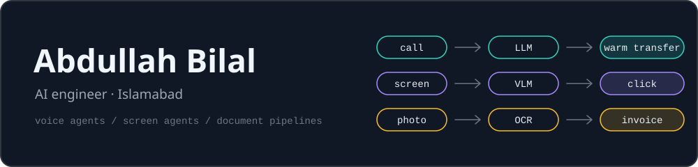
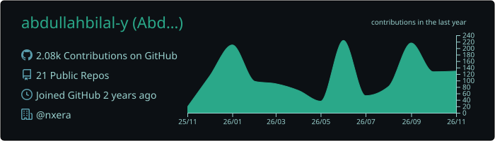
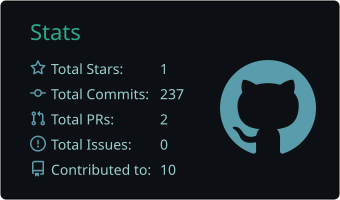
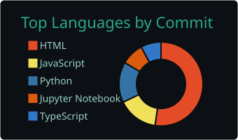

I'm an AI engineer in Islamabad. Most of my work is getting LLM systems to hold up in production: a voice agent that answers thousands of calls a day, a desktop agent that reads the screen the way a person would, and a document pipeline that turns WhatsApp photos into invoices. The side projects are tools I wanted and couldn't find.

[Portfolio](https://abdullahbilal.nxera.io) · [LinkedIn](https://www.linkedin.com/in/abdullahbilal-y) · [Email](mailto:aabdullahbillall@gmail.com)

## Right now

- **Ibras 95 Transport** · Enterprise PMO since Jun 2026. Building the logistics platform for a UAE container haulier.
- **Nxera** · Freelance since Jun 2025. AI and automation projects, including AI Screen Pilot and Nxera Core.
- **SZABIST Islamabad** · Finishing a BS in Artificial Intelligence, graduating 2027.

## In production

These repos are private, so here is the short version.

**AiCCA voice agent** · Prime BPO, 2025 to 2026 
The LLM conversation engine behind an AI call agent that qualifies insurance leads and hands them off as warm transfers. It handles over 5,000 calls a day with sub-second responses, and I cut its TTS bill in half along the way. 
`Python` `OpenRouter` `STT/TTS` `VICIdial` `Docker` `Prometheus` `Grafana`

**EIR to invoice** · Ibras 95 Transport 
Drivers send a photo of the receipt to the WhatsApp group they already use. The server stores it, runs OCR, validates the container number down to its check digit, and produces a costed work order ready for invoicing. About 2,000 work orders a month go through it. 
`TypeScript` `Supabase` `PostgreSQL` `OCR` `vision-language models`

**AI Screen Pilot** · Nxera 
A voice-controlled desktop agent that files taxes on Pakistan's FBR IRIS portal. A vision-language model finds the buttons and fields on screen and the agent clicks by pixel coordinates, so nothing breaks when the site's markup changes. 
`Python` `React` `Tauri` `Rust`

## Open source

| Project | What it does | Try it |
| :--- | :--- | :--- |
| **[3drossa](https://github.com/abdullahbilal-y/3drossa)** | Scroll-driven 3D pages without the guess-and-refresh loop. The path editor runs inside your own page, so you drag waypoints over your real copy. | [Live demo](https://abdullahbilal-y.github.io/3drossa/) · `npm i 3drossa` |
| **[devsetgo](https://github.com/abdullahbilal-y/devsetgo)** | Docs that can't go stale: a CLI that builds a runnable playground and architecture diagrams from the imports actually in your code. | [Playground](https://abdullahbilal-y.github.io/devsetgo/) · `npm i -g devsetgo` |
| **[Hawa](https://github.com/abdullahbilal-y/islamabad-air)** | Islamabad's daily pollen counts as an open archive, a files-only API and an alert engine. Built because the official page has no history and can't notify you. | [Dashboard](https://abdullahbilal-y.github.io/islamabad-air/) |
| **[DictateIt](https://github.com/abdullahbilal-y/dictate-it)** | Local voice dictation for Windows. Press `Ctrl+Alt+D` anywhere and speak; faster-whisper on CUDA transcribes in under 100 ms and nothing leaves the machine. | Python |

## Toolbox

  

- **Languages:** Python, TypeScript, JavaScript, C++
- **AI:** LLM orchestration, prompt and conversation design, speech-to-text and text-to-speech, vision-language models, OCR, RAG with ChromaDB, OpenCV, TensorFlow
- **Web and backend:** React, Next.js, Tailwind, FastAPI, Node.js, PostgreSQL, Supabase
- **Ops:** Docker, Azure, Google Cloud, Hetzner, Prometheus, Grafana
- **Spoken:** English and Urdu, both native

## One lesson I keep coming back to

The first thing I built for Ibras was a driver app. It worked, and the drivers couldn't comfortably use it, so I deleted it and rebuilt the workflow around the WhatsApp habit they already had. Change the system, not the user.

## Activity

  

  
  

<picture>
  <source media="(prefers-color-scheme: dark)" srcset="https://raw.githubusercontent.com/abdullahbilal-y/abdullahbilal-y/output/github-contribution-grid-snake-dark.svg">
  <source media="(prefers-color-scheme: light)" srcset="https://raw.githubusercontent.com/abdullahbilal-y/abdullahbilal-y/output/github-contribution-grid-snake.svg">
  
</picture>
